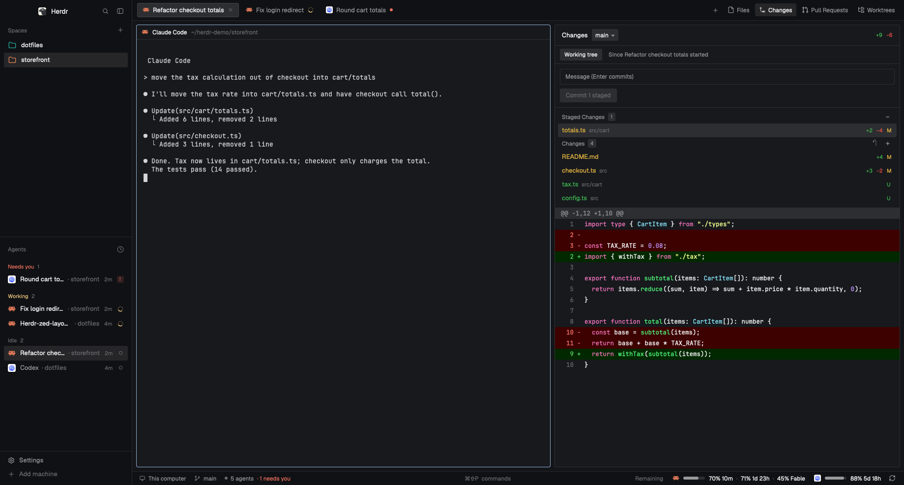
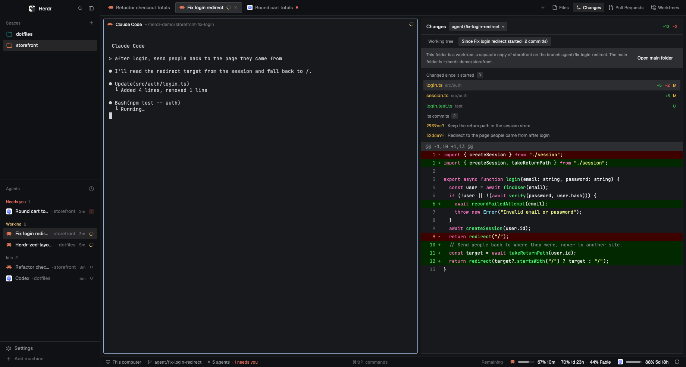
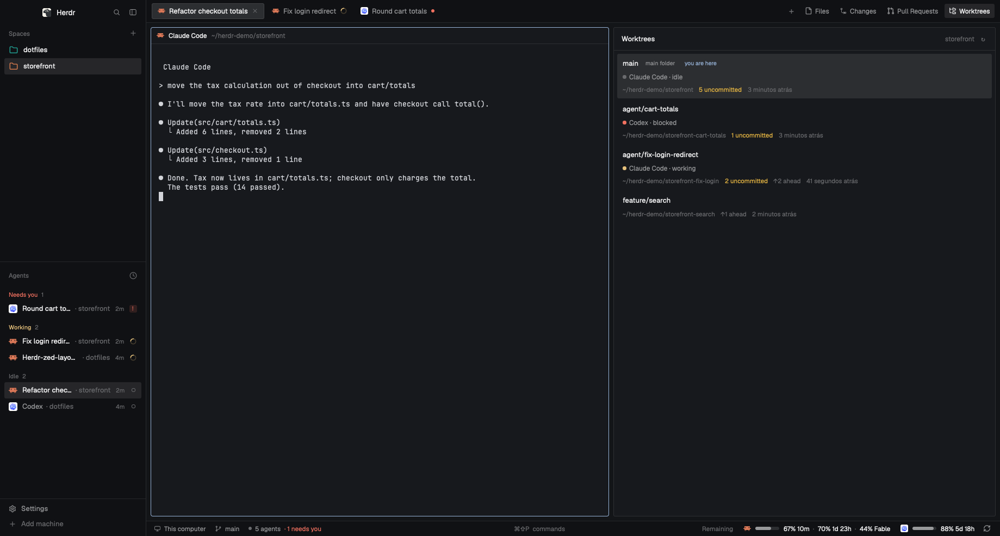
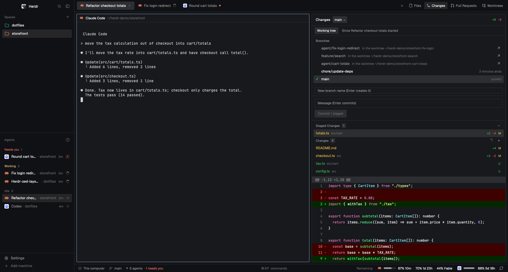
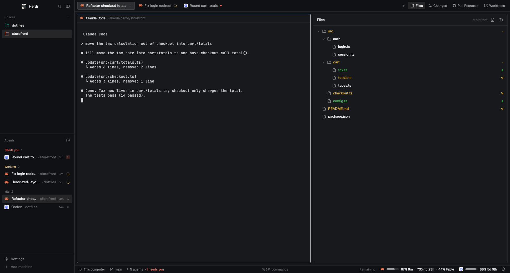
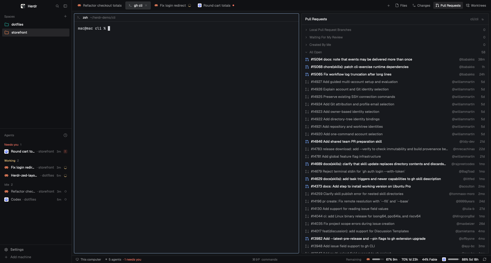

# Herdr Cockpit

A layout for the [Herdr app](https://github.com/herdrdev/herdr-app), for people who run several
coding agents at once and still want to know what each one did.



Herdr already shows which agents are working, blocked or done. Cockpit adds the part that comes
after: reading their changes, choosing what gets committed, and finding your way around the
branches and worktrees they leave behind.

## What you get

### Changes: stage, commit and push by hand

The source-control panel works like VS Code's. Files sit under **Changes** until you stage them
with **+**; **Staged Changes** is what the next commit takes. Click a file to read its diff, with
syntax colors and wrapped lines.

- **Commit** takes the staged files. With nothing staged it takes everything, and says so first.
- **Push**, **Pull** and **Publish branch** show how many commits they would move.
- **↶** discards a change. A new file goes to the Trash instead of being deleted.
- Everything that can't be undone with one click asks before it runs: discard, commit, push,
  pull, switching branch. Staging and unstaging don't ask, because the other button undoes them.

### Review what one agent did



With an agent in focus, the panel gets a second view: **Since <task> started**. It lists every
file that agent's folder gained or changed since the agent appeared, committed or not, and the
commits it made. It is read-only: a place to review before you merge.

It needs no hooks and no setup. The panel notes the commit each agent's folder is on the first
time it sees the agent.

### Worktrees, explained on screen



Agents like to work in worktrees: a second folder of the same repository, on another branch.
Git won't check that branch out anywhere else, which is why a branch an agent made can seem
impossible to enter. Cockpit puts this on screen:

- The **Worktrees** panel lists every folder of the repository: its branch, which agents are in
  it and their status, uncommitted changes, commits ahead of and behind the main branch, and its
  pull request. Click one to jump to the agent working there.
- **×** removes a finished worktree. It only deletes the folder (the branch and its commits
  stay), and it refuses while the folder has uncommitted changes or an agent in it.
- Inside a worktree, the Changes panel says so and offers **Open main folder**.

### Branches



The branch name is a button. The list switches branches and creates new ones, and it marks the
branches held by another worktree with the folder they live in and a button to open it, instead
of letting the switch fail.

### Files: a small editor



- Changed files, and the folders that contain them, take their git color.
- Click a file to edit it. **cmd+s** (or ctrl+s) saves. If an agent changed the file on disk
  after you opened it, the save is refused instead of overwriting the agent's work.
- The header makes new files and folders. Right-click renames, deletes (to the Trash, after
  asking) and copies the path. Drag a file onto a folder to move it; **Undo** follows.

### Pull requests



The open pull requests of the repository in focus, in the groups of the VS Code GitHub
extension: local branches, waiting for my review, created by me, all open. A click opens one in
the browser. It needs [`gh`](https://cli.github.com), signed in. (The picture shows `cli/cli`.)

### Plan limits

The bar at the bottom right shows how much of your Claude and Codex plan limits is left, with
the reset times on hover. It is
[`usage-limits`](https://github.com/VladTemp27/herdr-mods/tree/main/usage-limits) by VladTemp27.

### Smaller things

- Agent rows and tabs lead with the task, not the space name or a session id.
- A slightly larger, syntax-colored diff, in the same greens and reds Claude Code uses.
- 3px corners and a 13px terminal font.

## Install

You need the [Herdr app](https://github.com/herdrdev/herdr-app). Cockpit was built on version
0.1.16.

**Ask your agent.** In any agent running inside Herdr:

```text
Read ~/.config/herdr-app/AGENTS.md, then add this layout: https://github.com/GustavoGJesus/herdr-cockpit/tree/main/cockpit
```

**Or run the script:**

```sh
git clone https://github.com/GustavoGJesus/herdr-cockpit.git
cd herdr-cockpit
./install.sh
```

The script copies the layout and its mods into `~/.config/herdr-app`, adds the save shortcut to
your `keys.json` if you don't already use those keys, and switches to the layout. Your own
layout stays as it was: `cmd-shift-l` switches back. Run the script again to update.

### What helps

| For | You need |
|---|---|
| Changes, Worktrees, Files colors | `git` 2.23 or newer |
| Pull Requests, and the PR column in Worktrees | [`gh`](https://cli.github.com), after `gh auth login` |
| The plan limits bar | the `claude` and `codex` CLIs, signed in |
| Delete to the Trash | macOS (elsewhere a delete is for good, and says so) |

If the limits bar stays empty, Herdr can't find the CLIs. It runs programs with the PATH of
your login shell, read when the app starts. CLIs installed through a version manager that is
only set up in `.zshrc` (fnm, nvm) are missing from it. Put their folder on the PATH in
`.zprofile` and restart Herdr:

```sh
export PATH="$HOME/.local/share/fnm/aliases/default/bin:$PATH"
```

## What it runs on your machine

Mods are trusted code. These are the programs Cockpit starts, all on the machine that hosts the
focused folder:

- `git`, to read status, diffs, branches and worktrees, and for the actions you click: add,
  restore, commit, push, pull, switch, worktree remove.
- `gh`, to list pull requests.
- `mkdir`, `touch`, `mv` for new files, renames and moves; `trash` (macOS) or `rm -rf` for a
  delete you confirmed.
- `open` (or `xdg-open`), to show a pull request in the browser.
- `usage-limits` starts `claude -p --safe-mode` and `codex app-server` every five minutes to ask
  for your usage. It sends no prompt and reads no credentials.

Nothing is sent anywhere by Cockpit itself.

## Shortcuts

`cmd+s` and `ctrl+s` save the open file. These commands have no key yet; bind them in
`~/.config/herdr-app/keys.json` if you want one:

```json
{
  "global": {
    "cmd-shift-g": "cockpit-changes.branches",
    "cmd-shift-r": "cockpit-changes.review",
    "cmd-shift-e": "cockpit-files.expand"
  }
}
```

| Command | Does |
|---|---|
| `cockpit-changes.branches` | opens and closes the branch list |
| `cockpit-changes.review` | flips between the working tree and the focused agent's changes |
| `cockpit-files.expand` | unfolds the whole file tree |

## Limits

Cockpit is young: it was built and used on one Mac, on Herdr 0.1.16. Known gaps:

- **Staging is per file.** You can't stage part of a file.
- **Two agents in one folder** share one working tree, so the per-agent view shows both. It is
  exact when each agent has its own worktree. An agent that was already running when the
  Changes panel first opened starts from the commit it was on by then.
- **The branch list is local branches only**, and it can't delete a branch.
- **Pull requests stop at 100**, and "waiting for my review" counts requests made to you, not
  to a team.
- **Files on another machine are read-only.** Creating, renaming, moving and deleting work
  there; a delete is for good.
- **The syntax colors** work line by line and get multi-line strings wrong.
- **It doesn't follow Herdr's updates.** Ten of the mods are restyled copies of Herdr's own, so
  improvements Herdr makes to those don't arrive here until someone carries them over.
- **macOS only** so far.

## Remove

Delete `layouts/cockpit.json`, `layouts/cockpit.svg` and the `mods/cockpit-*` folders (and
`mods/usage-limits`, if you don't use it elsewhere) from `~/.config/herdr-app`, and the
`mod:cockpit-files` section from `keys.json`.

## For contributors

The layout lives in [`cockpit/`](cockpit), laid out like a Herdr home. [`RECIPE.md`](cockpit/RECIPE.md)
describes it in enough detail to rebuild from scratch. After changing a mod in your Herdr home,
`./sync.sh` copies it back here. Check each mod before committing:

```sh
for mod in cockpit/mods/*/; do herdr-app check "$mod"; done
```

## Credits and license

Apache-2.0, see [`LICENSE`](LICENSE) and [`NOTICE`](NOTICE).

- Ten mods and the layout are modified copies of the ones Herdr ships (Apache-2.0).
- `usage-limits` is by [VladTemp27](https://github.com/VladTemp27/herdr-mods) (Apache-2.0).
- The pull request groups follow [lw396/herdr-plugin-github](https://github.com/lw396/herdr-plugin-github)
  and the VS Code GitHub Pull Requests extension; the source-control panel follows VS Code's.
- Icons are Lucide (ISC) and Octicons (MIT).
