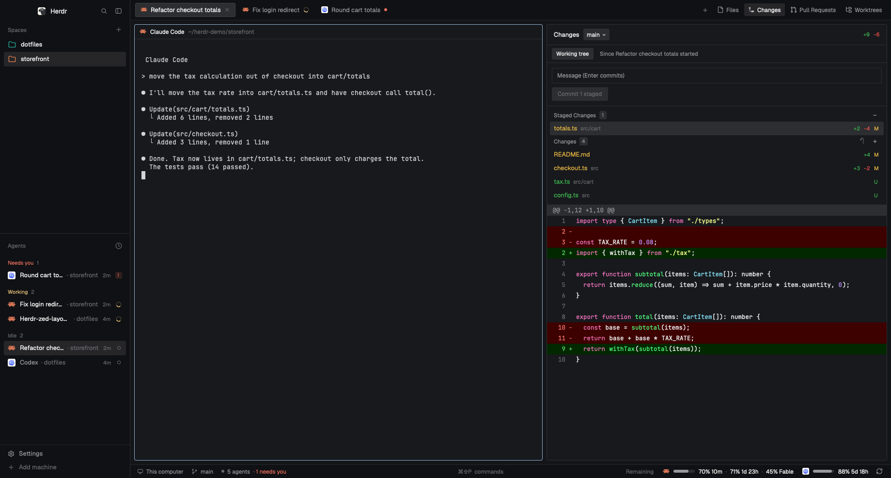

# Cockpit

Herdr's main window, reworked for people who run several coding agents at once and still want to
see what each one did. The side panel becomes a small source-control desk: stage and commit by
hand as in VS Code, review everything an agent changed since it started, see every worktree and
who is working in it, browse and edit files, and list open pull requests. A bar at the bottom
shows the Claude and Codex plan limits.

## What you see

Left to right, as Herdr's `main` layout. Corners are 3px everywhere (pane cards 4px), the terminal
font is 13px, and all colors are the theme's except the git colors below.

- **Sidebar**, 268px, `chrome`: the brand row (46px), Spaces and Agents sharing the height, the
  Settings / Add machine footer (69px).
  - A space row shows a 16px folder icon in the space's color, not a letter tile.
  - An agent row leads with its task (the terminal title); the space follows, dim, only when the
    list spans more than one space. A title that is only an id (Codex before a thread has a
    title) is replaced by the program's name.
- **Tab bar**, 42px: tabs as pills, then **+**, **Files**, **Changes**, **Pull Requests**,
  **Worktrees** (12px text, 26px tall; the shown panel's button has the `selected` background).
- **Panes**, 8px padding and gaps, cards with a 1px `border` (focused: `accent`) and a 30px header.
- **Side panel**, 368px (280–900), hidden until a panel button is pressed: a stack of the four
  panels. Each is a card with a 42px header (title, semibold; context on the right, 12px dim).
- **Status bar**, 28px: Herdr's status on the left half, `usage-limits` on the right half.

Git colors, the same in every panel (dark / light): added `#3fb950` / `#1a7f37`, modified
`#e3b341` / `#9a6700`, deleted or conflict `#f85149` / `#cf222e`. Diff rows are solid:
added `#022800`, removed `#3d0100` (light: `#b4ecc0`, `#ffc9d0`).

**Changes**, top to bottom:

- Header: **Changes**, the branch as a button (`main ▾`), the totals `+N −N`.
- With an agent in the focused pane, a two-part switch: **Working tree** and
  **Since <task> started · N commit(s)**.
- In a linked worktree, a `raised` strip: "This folder is a worktree: a separate copy of
  <repo> on the branch <branch>. The main folder is <path>." and **Open main folder**.
- The branch list (when open): one 28px row per local branch, newest commit first; ✓ and
  "current" on the checked-out one; a branch held by another worktree is dim, says "in the
  worktree <path>" and has **↗**; then a "New branch name" field.
- The message field (32px) and **Commit N staged** / **Commit all**; on the right **Pull ↓N**,
  **Push ↑N**, **Publish branch** or "Up to date with the remote".
- A confirmation strip (accent bottom border) when an action asks first.
- **Staged Changes** and **Changes**: 26px headings with a count and the section's buttons, then
  28px rows: file name in its status color (struck through when deleted), folder (11.5px dim),
  `+N −N`, the letter (M, A, D, U untracked, C conflict). On hover the numbers give way to the
  row's buttons: **↶** and **+** on a change, **−** on a staged one.
- The diff, 12.5px code font, 22px rows that wrap to the panel width: line number and `+`/`−` in
  a bright tone of the row color, syntax-colored code (keyword `#ff79c6`, string `#f1fa8c`,
  number and constant `#bd93f9`, function `#50fa7b`, type `#8be9fd`, comment `#8b949e`).
- In the "since started" view: **Changed since it started** (rows without buttons) and
  **Its commits** (short hash in the modified color, subject).

**Worktrees**: one block per worktree: the branch (medium), the badges **main folder** and
**you are here**; a line per agent in it (7px status dot, program, status); then 11.5px facts:
the folder with `~`, `N uncommitted` (modified color), `↑N ahead`, `↓N behind` (against the main
folder's branch), `PR #N open|draft|merged|closed`, the last commit's age. On hover **↗** and,
except on the main folder, **×**.

**Files**: a tree of 28px rows, 18px per level: chevron, folder or file icon, name, a status
letter on the right. A changed file's name takes its status color; a folder with changes inside
takes it too, with a `•`. The row touched last has the `selected` background. Header buttons:
new file, new folder. An open file replaces the tree with an editor (line numbers, soft wrap,
the syntax colors above), **←**, the path with `●` while unsaved, and **Save**.

**Pull Requests**: the repository (`owner/repo`) and **↻** in the header; four foldable groups
with counts, **Local Pull Request Branches**, **Waiting For My Review**, **Created By Me**,
**All Open** (the only one open at start); 28px rows: a 14px state icon (open `done`, draft
`dim`), `#number title`, `@author`, age.

## How it behaves

- **Agent statuses** are Herdr's: working (a spinning arc), blocked ("Needs you"), done, idle.
  The Worktrees panel repeats them as a dot per agent: `working`, `blocked`, `done`, `idle`.
- **Staging**: **+** stages a file, **−** unstages it, the section buttons do all of them. Neither
  asks: nothing is lost and the opposite button undoes it.
- **Everything else asks first**, in the confirmation strip, saying exactly what will happen:
  discard (one file or all), commit, push, publish, pull, switch branch, create branch.
- **Commit** takes the staged files; with nothing staged it takes every change, and the button
  and the question say so. Enter in the message field asks too.
- **Discard** restores tracked files from the index; a new (untracked) file goes to the macOS
  Trash, and on another machine or OS it is removed for good (the question says which).
- **Diffs**: a staged row shows what the commit takes (`git diff --cached`), a change shows what
  is only in the working tree. The first listed file's diff shows until another is clicked.
- **Since started**: the panel notes the commit each local agent's folder is on the first time
  it sees the agent, and keeps it in shared state across restarts. The view lists
  `git diff <that commit>` plus untracked files, and `git log <that commit>..HEAD`. Read-only.
- **Branches**: a click on a branch asks, then `git switch`. A branch in another worktree can't
  be switched to; its **↗** opens that folder in a new tab. Enter in the field asks, then
  `git switch -c`.
- **Worktrees**: a click on a block focuses the agent working there, or opens the folder in a
  new tab when there is none. **×** asks, then `git worktree remove`; it is refused while the
  folder has uncommitted changes or an agent in it. The branch is never deleted.
- **Files**: a click opens a file or folds a folder. cmd+s / ctrl+s (or **Save**) writes the
  file; the write is refused when the file changed on disk since it was opened. Leaving with
  unsaved edits asks Save / Discard / Keep editing, and unsaved edits keep the panel on the file
  when the focus moves. Right-click: Rename, New file here, New folder here, Copy path, Delete
  (asks; Trash on this Mac). Dragging a row onto a folder moves it there (onto a file: that
  file's folder; below the rows: the root), with **Undo** in the note that follows.
- **Pull Requests**: a click opens the PR in the browser. Refreshes every 2 minutes and on **↻**.
- Every panel follows the focused pane's folder, on the machine that hosts it.

## Built from

- `layouts/cockpit.json`: Herdr's `main` tree with the cockpit mods, `font_size: 13`, pane
  `radius: 4`, `terminal_menu: "cockpit-menu"`, four blocks in the `panel-body` stack (`files`,
  `changes`, `pulls`, `worktrees`) and a `status` row of `cockpit-workspace-status` and
  `usage-limits` (`{ "align": "right" }`), each `weight: 1`.
- Clones of Herdr 0.1.16's shipped mods, restyled (`.rounded(3)`): `cockpit-workspace-chrome`,
  `cockpit-spaces` (folder icon), `cockpit-agents` (task-first rows), `cockpit-tabs` (id-like
  titles, the two extra panel buttons), `cockpit-pane`, `cockpit-workspace-status`,
  `cockpit-menu`, `cockpit-new-menu`.
- `cockpit-changes` (`main.js`, `syntax.js`): source control, branches, the per-agent review.
- `cockpit-files` and `cockpit-file-menu` (the right-click popup; it answers through the shared
  key `cockpit-files.action`).
- `cockpit-pulls`, `cockpit-worktrees`.
- `usage-limits` from VladTemp27/herdr-mods, with a smaller corner radius.
- Shipped mods used as they are: `worktree`, `machine-add`, `confirm`, `prompt`, `toast`, and the
  icons in `mods/workspace-chrome`, `mods/files`, `mods/changes`, `mods/pane`.
- `herdr` functions: `exec`, `readTextFile`, `writeTextFile`, `watchFolder`, `spaces`, `panes`,
  `agents`, `focused`, `shared` / `setShared` (`cockpit.agent-baselines`,
  `cockpit-files.action`), `openOverlay`, `closeOverlay`, `nextCommand`, `run` (`tab.new`,
  `pane.focus`, `layout.select`, `layout.show`, `layout.hide`), `theme`, `settings`, `window`.
- Programs: `git`, `gh` (optional), `sh`, `test`, `mkdir`, `touch`, `mv`, `rm`, `trash` (macOS),
  `open` / `xdg-open`; `usage-limits` runs `claude` and `codex`.
- Commands for keys.json: `cockpit-files.save` (bound to cmd-s and ctrl-s in `keys.json` here),
  `cockpit-files.expand`, `cockpit-changes.branches`, `cockpit-changes.review`.

## Watch out

- Write a new mod's `mod.json` (`"place": "none"`) before its `main.js`: a folder Herdr first
  sees without it gets docked into the shown layout as a root block.
- Mods can't import each other: the git colors and the syntax colors are repeated in
  `cockpit-changes` and `cockpit-files`. Keep them in step.
- The clones don't follow Herdr's updates. After a Herdr release, compare them with the shipped
  mods and carry the changes over.
- A `cx.stop_propagation()` in a row's mouse-up can swallow its click; the drag code only stops
  the mouse-move.
- A copy starts the first time it shows: agents are only given a starting commit once the
  Changes panel has been opened in that window, and an agent already running by then starts
  from the commit it is on.
- Two agents in one folder share one working tree, so "since started" can't tell them apart.
  It is exact when each agent has its own worktree.
- Herdr runs programs with the login shell's PATH read at launch. CLIs installed with a version
  manager set up only in `.zshrc` (fnm, nvm) are not found: put their folder on the PATH in
  `.zprofile` and restart Herdr.
- `git commit` runs your hooks and signing; a signing key that asks for a touch asks here too.
- The syntax coloring works line by line and gets multi-line strings wrong.
- Staging is per file, the branch list is local branches only, and pull requests stop at 100.
- Only local files are written: on another machine files are read-only, though creating,
  renaming, moving and deleting work there (deleting is for good).
- Tested on macOS only.

## Done when

- `herdr-app check` passes for every `cockpit-*` mod and for `usage-limits`.
- In a repository with changes, Changes lists them under **Changes**; **+** moves a file to
  **Staged Changes** and the button reads **Commit 1 staged**.
- Commit, discard, push, pull and a branch switch each show the confirmation strip first, and
  Cancel changes nothing.
- With an agent focused, **Since <task> started** lists the files changed and the commits made
  after the agent appeared.
- In a repository with a second worktree, Worktrees lists both, marks **you are here**, and the
  branch list shows the other branch as "in the worktree …" with **↗**.
- A file opened in Files can be edited and saved with cmd+s, and the tree shows it in the
  modified color.
- In a repository with a GitHub remote and `gh` signed in, Pull Requests lists the open PRs.
